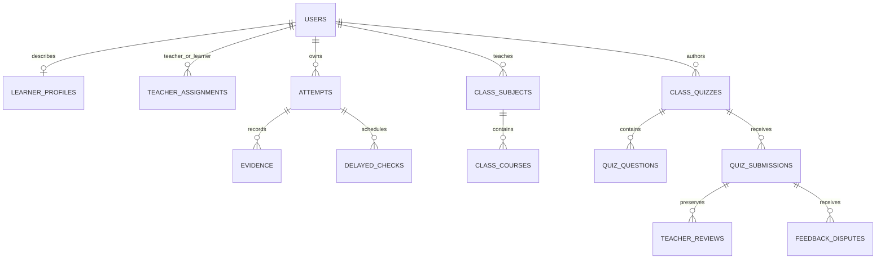

# Data architecture and real classroom use

Beyond Marks has a persistent FastAPI backend. The browser sends authenticated requests through the Next.js proxy; FastAPI checks ownership, validates stage transitions, writes PostgreSQL transactions and returns safe response objects. Supabase supplies PostgreSQL storage. Authored questions are learning content, not fabricated learner results.

## Identity and storage growth

A student's `user_id` is their identity; a learner profile refers to that identity. A teacher assignment stores two references, not copies of either account. One teacher with 100 students needs 100 assignment rows. This does not grow exponentially. Subjects, lessons and quiz questions belong to the teacher and are shared through assignments rather than duplicated for every student.

Storage grows with accounts, enrollments, authored content and actual learning activity. Preserving evidence deliberately costs storage proportional to the number and size of submissions and snapshots. PostgreSQL disk storage is separate from the application process's working memory. Neither storage nor memory is unlimited, and no production load capacity has been established.

Classroom reads batch related records. Quizzes, submissions and teacher timelines have bounded pages. Latest investigation history is selected in PostgreSQL. Course recommendations use a per-learner/course summary rebuilt after grading and teacher review; it is a derived read model, not a replacement for original evidence. Some collections, including subject lists and delayed-check history, still need further pagination for very large deployments.

## From demonstration to genuine evidence

- Curriculum-only seeding creates questions and lessons without invented students or results.
- Explicit demo seeding creates labelled sample accounts and history.
- Clean pilot bootstrap creates a new schema, one teacher and curriculum, with no learner activity. It refuses existing schemas.
- Students join using their teacher's enrollment code and produce their own attempts, explanations and submissions.
- Eligible completed investigations schedule checks at actual completion time plus 7 and 30 days. The server withholds future tasks and rejects early submission. Only a submitted delayed response produces a result.
- Account origins are `demo`, `pilot` or `unverified`; absence of a sample flag does not prove that a record came from a real participant. Demonstration accounts can be explicitly reclassified without deleting history.

For an existing installation, run migrations and `python -m app.maintenance rebuild-progress --apply` before relying on recommendation summaries. Review and run expired-session cleanup separately; it never deletes learning evidence.

## Evaluation still required

Recruit an appropriate classroom cohort with permission, record a baseline, observe transfer and independent work, then wait for the actual delayed checks. Report participation, missed checks and teacher corrections alongside outcomes. Compare equivalent tasks rather than improvement on a remembered answer. The current release implements this collection workflow; it does not claim a completed study or a causal learning benefit.
